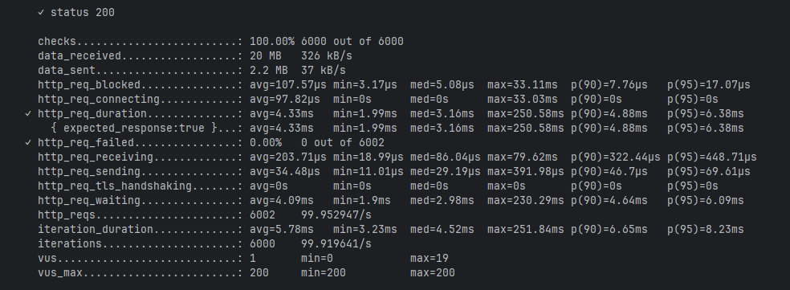

# Room Booking

Сервис бронирования переговорок на Go (тестовое задание на стажировку Backend в Авито, 2026).

[](https://github.com/Yashi213/room-booking/actions/workflows/ci.yml)

## Возможности

- Регистрация и вход по JWT, роли `admin` и `user` (плюс `/dummyLogin` для быстрого получения токена).
- Переговорки: создание и список.
- Расписания комнат: дни недели и рабочие часы, из которых генерируются слоты.
- Слоты: список свободных слотов комнаты на дату.
- Брони: создание, отмена, список своих броней, общий список для администратора.
- Опциональная ссылка на видеоконференцию через внешний сервис (мок) с таймаутом и компенсацией.
- OpenAPI-спецификация ([`api.yaml`](api.yaml)) и Swagger UI.

## Архитектура

```
             ┌──────────────── nginx gateway :8080 ────────────────┐
             │                                                     │
             ▼                                                     ▼
   app (cmd/app)                                            swagger-ui
   handler → service → repository ──► PostgreSQL ◄── slotworker (cmd/slotworker)
                │
                └──► conference (мок внешнего сервиса)
```

- **handler**: HTTP-слой на chi, роуты и модели сгенерированы `oapi-codegen` из `api.yaml`, маппинг доменных ошибок в коды ответа.
- **service**: бизнес-логика (проверка ролей, слотов, конфликтов броней, работа с конференциями).
- **repository**: доступ к PostgreSQL через pgx.
- **slotworker**: отдельный процесс, раз в сутки по cron догенерирует слоты на седьмой день вперёд.
- **gateway**: nginx на одном порту проксирует API и Swagger UI, поэтому отдельная настройка CORS не нужна.

## Стек

Go, chi, pgx, JWT (golang-jwt), oapi-codegen, swag, PostgreSQL 16, Docker Compose, k6, testify + mockery, golangci-lint, GitHub Actions.

## Запуск

```bash
make up        # docker compose up -d --build
make down
```

Сервис доступен на **http://localhost:8080**, Swagger UI находится там же. Переменные окружения описаны в [`.env.example`](.env.example).
Чтобы запустить приложение без Docker, нужен PostgreSQL и переменная `DATABASE_URL`.

## Как появляются слоты

1. При создании расписания сразу создаются слоты на неделю вперёд.
2. Затем фоновый воркер `slotworker` каждый день в 03:00 UTC создаёт новые слоты на седьмой день: день закончился, на ближайшие шесть дней слоты уже есть, воркер доделывает слоты на седьмой день.
3. По запросу `GET /rooms/{roomId}/slots/list` на дату, не входящую в семидневное окно, идёт ленивая генерация.

**Обоснование.** В ТЗ указано, что запросы слотов в основном укладываются в **ближайшие 7 дней** — поэтому основной объём 
создаётся при создании расписания и доделывается воркером: самый частый сценарий — чтение из БД без тяжёлой генерации в запросе. 
Раз в сутки окно сдвигается вместе с датой. В 0.01% случаев приходится догенерировать слоты во время запроса, что не критично 

## Ссылка на конференцию (мок Conference Service)

В `POST /bookings/create` есть необязательное поле `createConferenceLink`. Если оно `true`, перед сохранением брони
вызывается мок [`internal/conference`](internal/conference/conference.go) с таймаутом `CONFERENCE_SERVICE_TIMEOUT_MS` (по умолчанию 3000 ms).

- Мок недоступен, вернул ошибку, пустую ссылку или не ответил вовремя: бронь не создаётся, ответ **503** `CONFERENCE_UNAVAILABLE`.
- Ссылка получена, но вставка брони упала с конфликтом по слоту: ссылка отменяется через `CancelConferenceLink` (компенсация), ответ **409**.

## Тесты

```bash
make test-unit          # юнит-тесты сервисов и хендлеров на моках
make test-integration   # сценарии через API на поднятом стеке (docker compose --profile test)
make lint               # golangci-lint
```

В CI на каждый push и pull request запускаются сборка, `go vet`, юнит-тесты и golangci-lint.

## Нагрузочное тестирование

Сид ([`scripts/seed.py`](scripts/seed.py)) очищает таблицы и наполняет БД в рамках верхних границ ТЗ:
**50 переговорок, 10 000 пользователей, 100 000 броней** (до 1000 активных, остальные отменённые).

```bash
make seed   # docker compose --profile seed run --rm seed
```

Сценарий k6 [`tests/load/load.js`](tests/load/load.js) нагружает самый тяжёлый эндпоинт `GET /rooms/{roomId}/slots/list`
с постоянной интенсивностью около **100 RPS**; пороги в `options.thresholds` задают долю ошибок и p95 времени ответа.

```bash
docker run --rm -i -v "${PWD}/tests/load:/scripts:ro" -e BASE_URL=http://host.docker.internal:8080 grafana/k6:0.57.0 run /scripts/load.js
```

**Результат:** на данных после сида ошибок практически нет, **p95 заметно ниже 200 ms**.


